# Qeni — ESP32-S3 Wearable
Qeni is a custom wearable device based on the ESP32-S3,
designed and developed as a complete electronic product.

The project covers the complete hardware development process,
from system architecture and component selection to PCB and
mechanical design, manufacturing and validation.

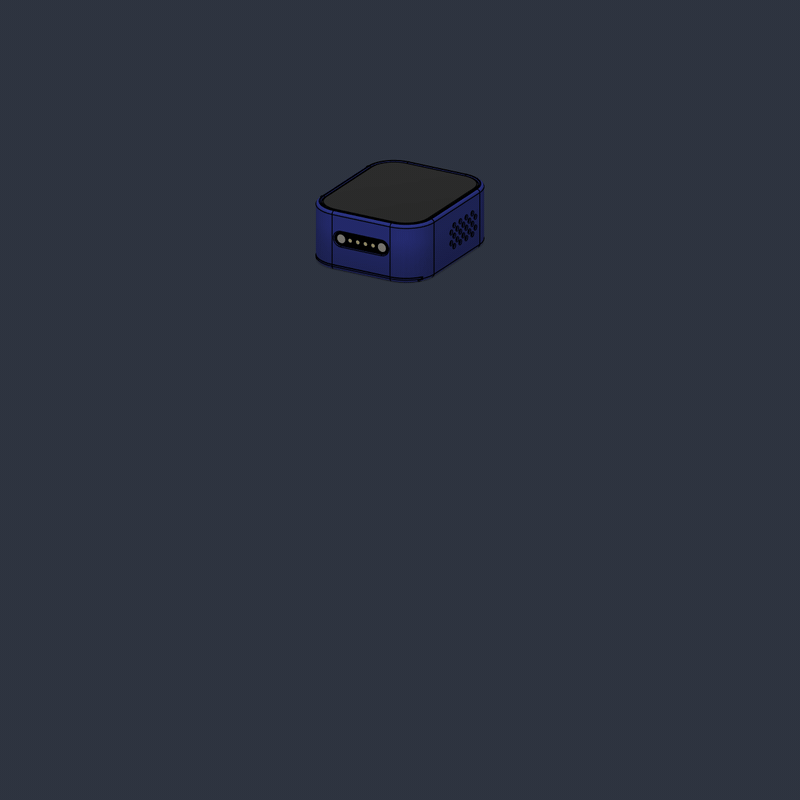

## Manufactured prototype
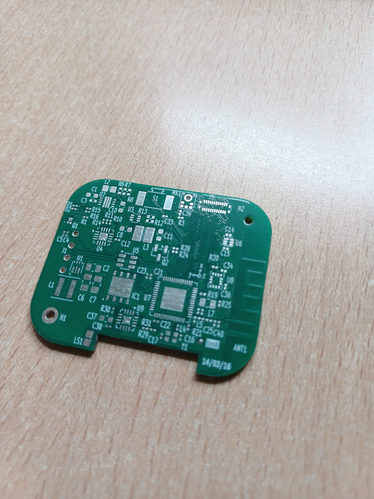
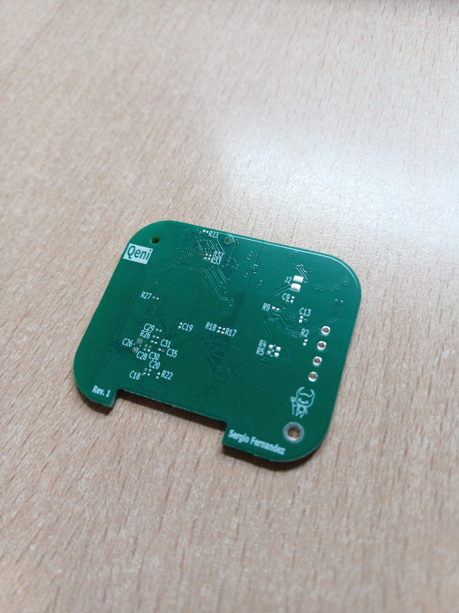
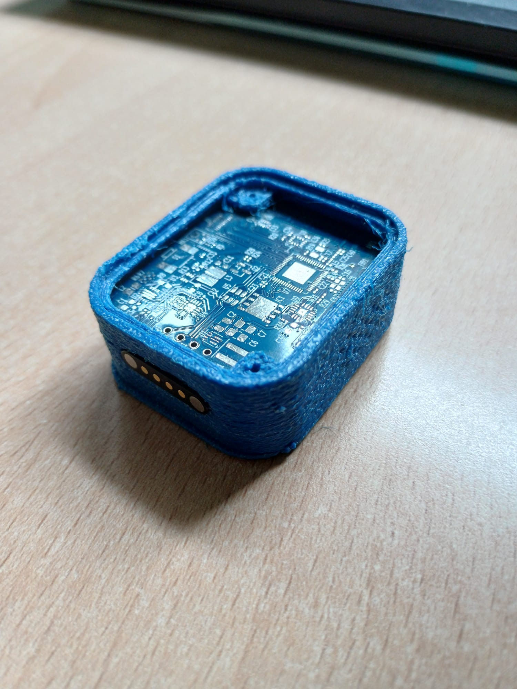

## System Architecture

### High level organization
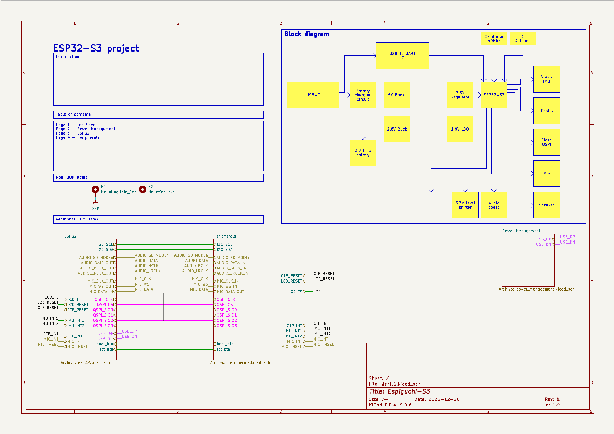

### Power management
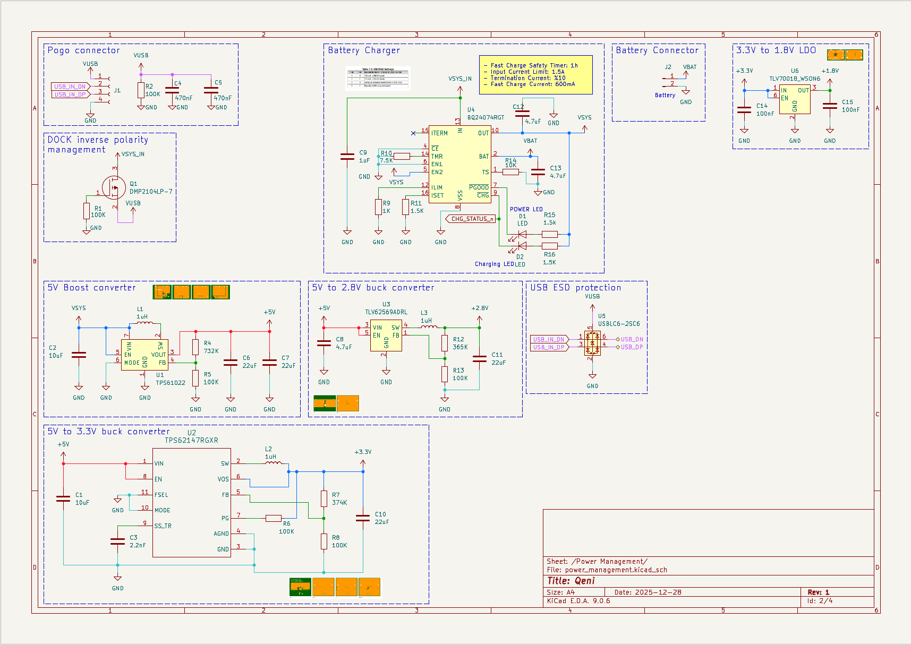

### ESP32 and QSPI memory
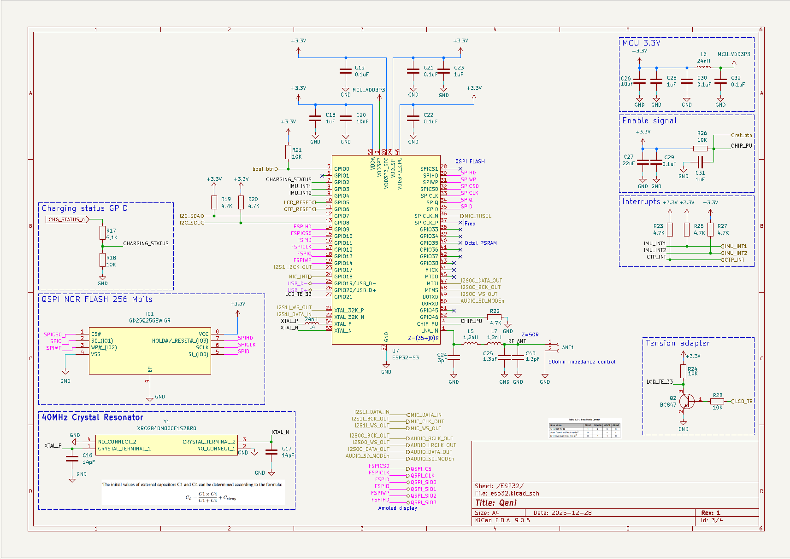

### Peripherals
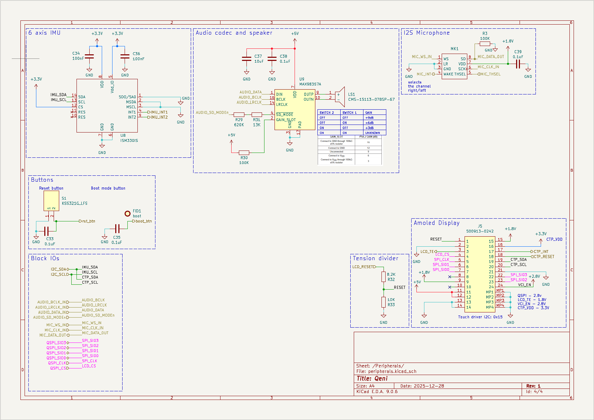

Brief explanation of the main subsystems...

## The PCB design
The PCB design has 4 layers in order to have enough grounding, layer 2 and 3 are solid ground planes. The stack up has been modified to meet the assembler requiremts as well as a proper width and spacing for differential traces. 

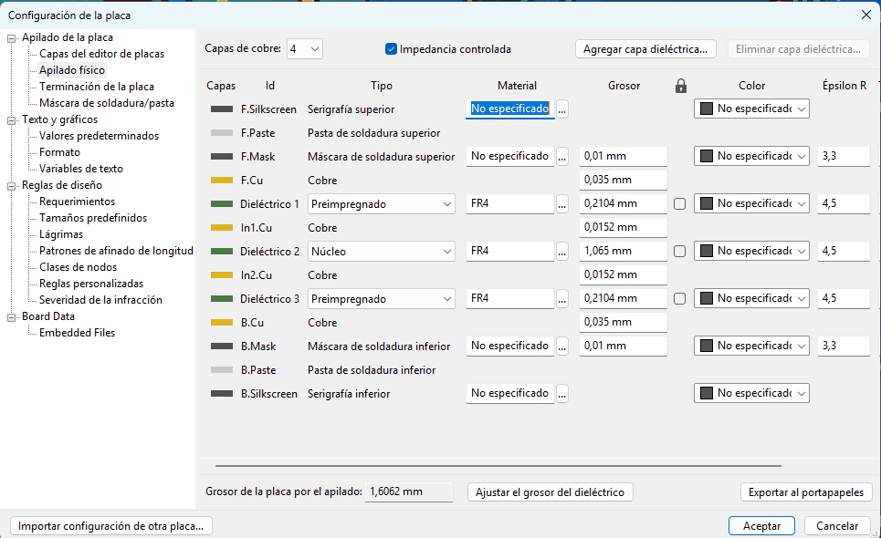

### Considerations
- The type and size of the vias have been chosed for a cheap manufacturing
- Components without Pb have been selected in order to meet EU requirements and RoHS
- Most components have been placed on top side for mechanic reasons
- QSPI and SPI traces need controlled length to meet timing requirements
- USB-C and RF traces are impedance-controlled through their width and spacing
- Layers 2 and 3 provide return paths for high-speed signals, reducing unwanted emissions and crosstalk between adjacent traces
- Ground vias are placed near high-speed signal vias to maintain a continuous return path when signals transition between layers

### Layer 1
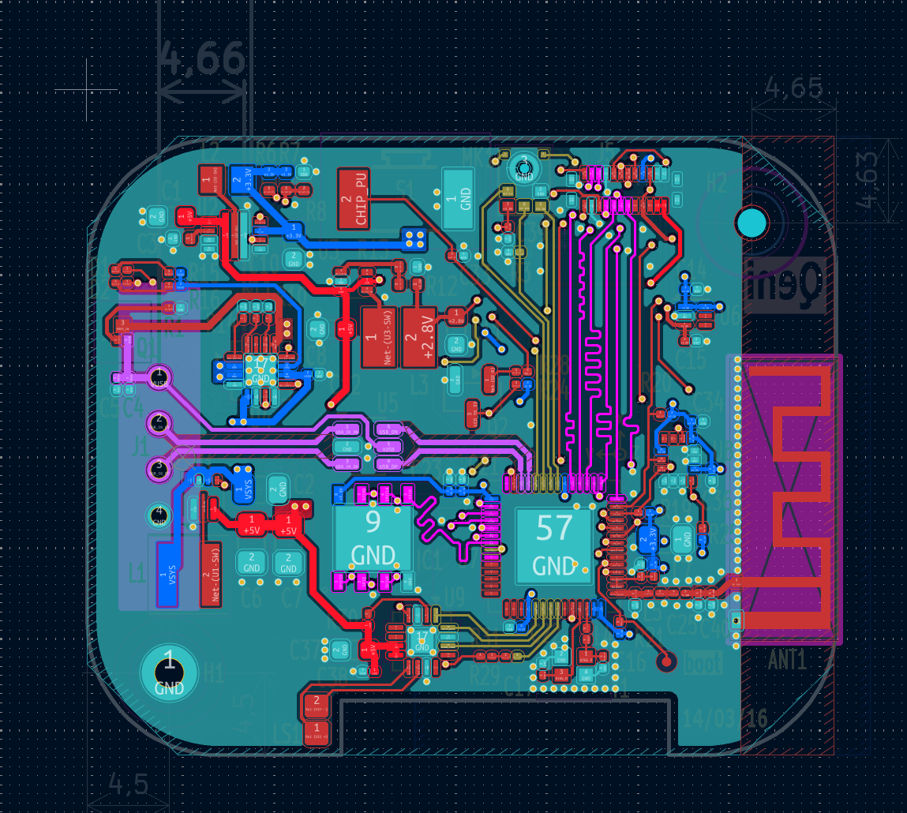

### Layer 2
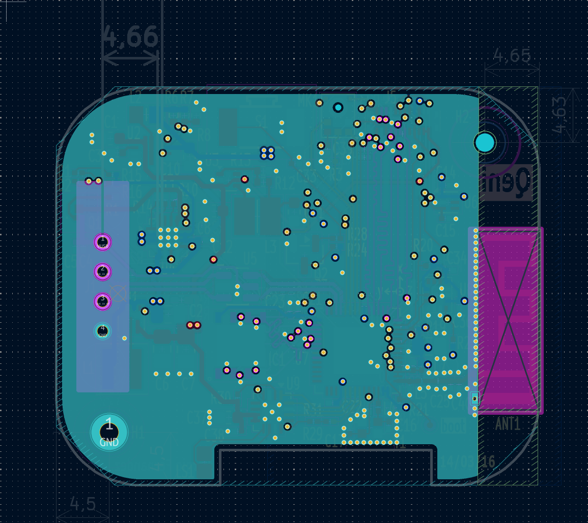

### Layer 3

### Layer 4
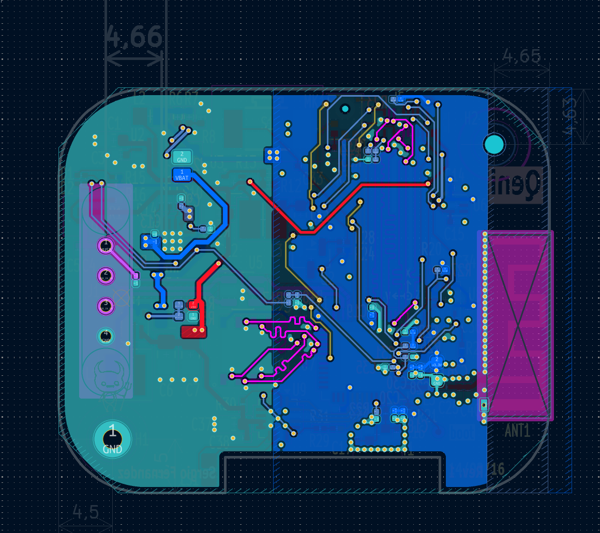

### PCB renders

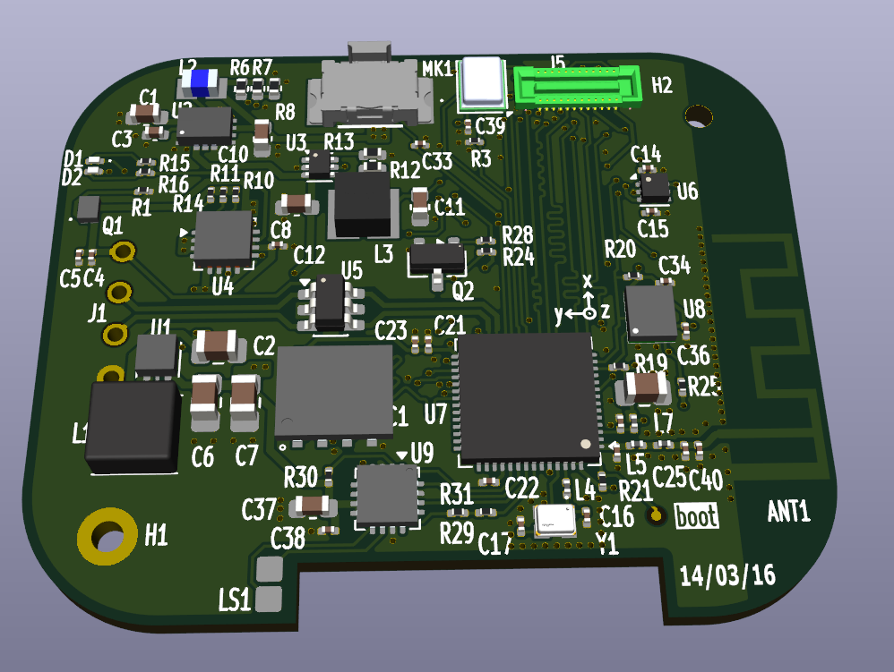
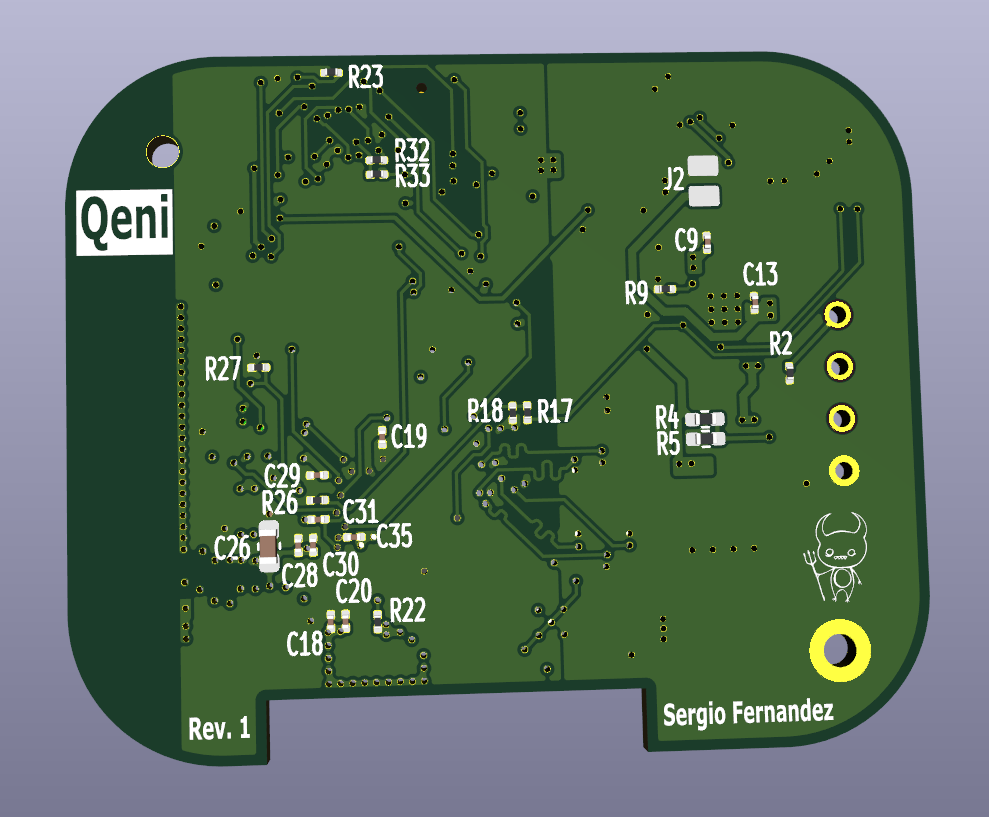

## Main Components

- ESP32-S3
- AMOLED display
- Touch controller
- Switch
- IMU
- Speaker
- Microphone
- Audio driver
- Li-Po battery management ICs
- Power management ICs (charging and safety)

### Component Selection

Components were selected considering:

- Electrical requirements
- Availability and lifecycle
- Cost
- Package constraints
- Manufacturing requirements
- Applicable certifications/regulations
- Available support for software development

## Technologies

`ESP32-S3` `ESP-IDF` `C` `KiCad` `Fusion 360` `PCB Design`
`Embedded Systems` `Electronics` `Hardware Validation`